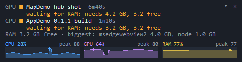
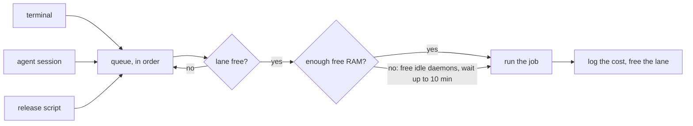
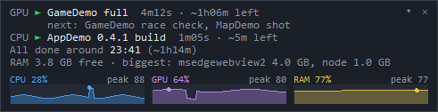

# HeavyGate

**Air traffic control for your workstation.** One command in front of your builds, test suites, renders and deploys, so
they take turns instead of taking down the machine.



```
heavy cpu -n "App release build" -- ./gradlew assembleRelease
heavy gpu -n "Game full suite"   -- ./test.sh full
```

No daemon, no container, no config, no dependencies. One Python file, on Windows and Linux.

## Why anyone cares

Your computer has no idea that the three things you just started all want the same 8 GB.

It used to take one person to overload a workstation. Now it takes one person with four terminals, two AI coding agents
and a CI script, all of them deciding on their own to run the full test suite right now. HeavyGate exists because of a
real night: two 3D test runs, a phone build and a Blender render started at the same time on a 16 GB PC and ran it out
of memory. Nothing was wrong with any of those jobs. They just had no way to know about each other.

CI servers solved this years ago with runners and queues. Your own machine still has nothing, and a full CI system is
absurd for one box. HeavyGate is the missing middle:

- **One job per lane.** Heavy GPU work and heavy CPU work each get a lane, so a build and a 3D test can overlap but two
  3D tests can't. It holds across every terminal, script and agent, because the lanes live in the OS, not in a shell.
- **It checks the RAM before it starts.** A job that has its lane still waits until enough memory is really free, and
  clears idle Gradle and Kotlin daemons if that helps.
- **RAM never goes past the ceiling (92%).** Every job runs under a hard memory cap set to what is left below the
  ceiling. A job is ended if the PC goes over 92% for 3 seconds, or reaches 95%. `heavy guard` does the same for any
  command a coding agent runs outside the lanes. List your agents' process names in `guard_agents` in `settings.json`
  (for example `["myagent.exe"]`); the list is empty until you do, so the guard ends nothing on its own.
- **A fair line.** First come, first served. A polling monitor can never cost a job its turn.
- **It can't jam.** Locks belong to the kernel. Kill a job, crash it, pull the plug: the lane frees itself. There are no
  stale lock files to delete at 2 am.
- **A stuck job gets noticed.** Alive but doing nothing for 5 minutes shows as STALLED, and `heavy stop` clears the lane. After 20 minutes with another job waiting, it is ended for you.
- **Your desktop stays usable.** CPU-lane jobs run at low priority on three quarters of the cores.
- **It learns how long things take.** Past runs give each job an estimate, so you get "All done around 23:40".
- **It keeps receipts.** `heavy log` shows what every job cost: time in line, time waiting for RAM, run time, lowest
  free RAM, CPU and GPU peaks.

## Where it fits

Put `heavy` in front of anything that hurts when two run at once. The exit code passes straight through, so scripts and
CI steps behave as they did before.

**Builds**

```
heavy cpu -n "Android release" -- ./gradlew assembleRelease
heavy cpu -n "Server publish"  -- dotnet publish -c Release
heavy cpu -n "Docs archive" --expect 6000 -- tar czf site.tgz public/
```

**QA and test suites**

```
heavy gpu -n "Browser 3D checks" -- npx playwright test
heavy gpu -n "Blender render"    -- blender -b scene.blend -a
heavy cpu -n "Unit tier"         -- pytest -n 8
```

**Deployments**

A release script can build and test through the lanes, then ship. If a gated script calls `heavy` again, the inner call
runs in its parent's slot, so it can't deadlock on itself.

```sh
#!/bin/sh
set -e
heavy cpu -n "Release build" -- ./build.sh
heavy gpu -n "Release QA"    -- ./qa.sh --full
./deploy.sh                  # light work stays outside the lanes
```

Skip a run when the machine is busy instead of queueing (a nightly job, say):

```sh
heavy cpu --no-wait -n "Nightly" -- ./nightly.sh
[ $? -eq 75 ] && echo "lane busy, skipped"
```

**AI coding agents**

Add one line to your agent instructions: *run builds and test suites through `heavy`.* Every parallel session then
queues in one line, and each agent gets the normal output and exit code back. `--no-wait` and `heavy status --json` let
an agent decide what to do while it waits.

**Your own tools**

```python
import subprocess, heavygate

with heavygate.hold('gpu', 'Nightly render') as slot:
    with slot.spawning():
        p = subprocess.Popen(['blender', '-b', 'scene.blend', '-a'], **slot.popen)
    slot.exit = p.wait()
```

Anything that polls the lanes uses `heavygate.peek()` / `peek_queue()` or `heavy status --json --peek`, which never
touch a lock.

## How it works



| Lane | For | How it runs |
| --- | --- | --- |
| `gpu` | 3D window checks, game QA, headless browser 3D, GPU renders | normal priority |
| `cpu` | Compiles, Gradle/Android builds, `dotnet publish`, CPU renders, big archives | low priority, three quarters of the cores |

The gpu lane runs one job and the cpu lane two (`cpu_slots`); the rest queue in arrival order. Before a job starts, the gate waits for enough free RAM: 3.5
GB for a gpu job and 2.5 GB for a cpu job, plus a 768 MB reserve. Change it per job with `--expect <MB>`. The job also waits until it fits under the RAM
ceiling (92% by default). After 10 minutes it starts if at least 1.5 GB is left under the ceiling, and records a warning.

**RAM ceiling.** On Windows each job runs inside a Job Object whose memory cap is what was left under the ceiling when it
started. Past that, the job's allocations fail, so a runaway compile stops itself instead of taking the PC to 100%. While
it runs, the job is ended if RAM stays over the ceiling for 3 seconds, or reaches 95%, whatever pushed it there (a job
under 300 MB is never blamed). `heavy guard` covers what never entered a lane. It ends the biggest command a coding agent
started (the shell its tool call opened, and everything under it), never the agent itself or anything you started
yourself. The tray, the agent hook and sign-in all start it. Its actions go to `guard.log`.

**Disk floor.** A full drive breaks git and every program writing to it, not just the build. So a job doesn't start
while the drive it runs in, the temp drive or the profile drive (where Gradle, NuGet and npm keep their caches) has under
`disk_floor_gb` free (15 GB). It's refused with exit 28 and a message naming the drive; from Python, `hold()` raises an
`OSError` with `errno.ENOSPC`. A running job is ended, also with exit 28, if one of those drives falls under
`disk_stop_gb` (3 GB), checked every 5 seconds. `disk_paths` adds more folders whose drives count. `heavy status` and the
tray show free space on each drive, and `heavy log` shows how far the job's drive went down while it ran (that includes
anything else writing there at the time). With the cloud lane, a mapped build goes to GitHub instead when the disk here
is under the floor.

## Install

You need Python 3.9 or newer. There's nothing else to install, and no admin or root rights are needed.

**Windows**

```powershell
git clone https://github.com/mikedopp/HeavyGate.git
cd HeavyGate
.\install.ps1
```

**Linux**

```sh
git clone https://github.com/mikedopp/HeavyGate.git
cd HeavyGate
./install.sh
```

Then open a new terminal and run `heavy status`. To remove it, delete the `heavy` launcher (`%LOCALAPPDATA%\HeavyGate\bin`
on Windows, `~/.local/bin` on Linux) and the state folder listed below.

## Commands

```
heavy gpu -n NAME -- COMMAND     run on the GPU lane (--expect MB, --no-wait)
heavy cpu -n NAME -- COMMAND     run on the CPU lane (also --threads N)
heavy auto -n NAME -- COMMAND    let the rules pick the lane and threads
heavy why -- COMMAND             where auto would send it, without running it
heavy hook -- COMMAND            what the agent hook would do to a command (no command: the hook itself)
heavy rules                      the rules window on Windows (--list prints them)
heavy status                     per lane: running, waiting for RAM, queued; hardware, RAM, CPU and GPU now
heavy status --json              the same, for other tools (--peek never touches a lock)
heavy watch                      the same, live
heavy log                        what each run cost
heavy stop LANE                  end the job holding a lane and everything it started
heavy free                       stop idle Gradle/Kotlin daemons (never during a build), unload Ollama's models
heavy deps                       everything it depends on and where it lives
heavy guard                      keep RAM under the ceiling: end the agent command that takes it past (background)
heavy guard --check              RAM now, every agent command with its size, and what the guard would end
heavy guard --at-sign-in on|off  start the guard at sign-in (Windows)
heavy service install|remove     Linux: the guard as a systemd user service (status: is it running; --dry-run)
heavy tray                       text strip above the clock, plus a tray icon (Windows)
heavy tray --at-sign-in on|off   start the tray at sign-in (Windows)
heavy shutdown-when-done         shut the PC down once both lanes are done; --off cancels (the tray on Windows,
                                 the guard on Linux)
heavy cloud                      the cloud lane: GitHub Actions minutes used and left, charges, runs, workflows
heavy cloud runs                 recent runs across your repos (--count N)
heavy cloud advise -- COMMAND    run it here or on GitHub, and what it would cost (--os, --est, -n NAME, --json)
heavy cloud dispatch REPO WF     start a workflow on GitHub; refused when the advice is to keep it here (--force, --ref,
                                 --wait follows it and brings its files back)
heavy cloud map REPO WF --match WORDS [--folder PART]   a build that may run as that workflow (no args: list them)
heavy cloud unmap N              remove a mapping
heavy cloud auto on|off          let heavy auto / heavy cpu send mapped builds to GitHub, within daily and monthly caps
heavy auto --cloud / --no-cloud  this one build: to GitHub on purpose, or always here
heavy cloud prune                delete artifacts older than cloud_keep_days now (--days N, 0 = all; --dry-run)
heavy cloud probe FOLDER         copy the runner probe into a checkout and print the workflow steps that start it
heavy cloud keep DAYS|off        how old an artifact may get on GitHub before heavy deletes it (default 3)
```

`--no-wait` exits with code 75 when the lane is busy, and a job refused or ended for disk space exits 28.
`HEAVYGATE=off` skips the gate entirely.

`heavy auto` picks the lane and threads from `rules.json` in the state folder, first match wins. A rule's `match` is whole
words anywhere in the command, and `folder` is any part of the working folder. A command no rule knows takes the CPU lane
at the usual share. An explicit `--threads` beats the rule. The rules window edits the same file and suggests rules from
what past runs used; it is Windows only for now, and `heavy rules --list` prints the rules anywhere.

`--threads N` gives one CPU lane job N logical processors instead of the `cpu_threads` setting. It still runs at
below-normal priority, a number above what the machine has means all of them, and the setting is untouched for the next
job. `status` and `log` show each job's count. GPU jobs have no limit, so the flag is refused there. Inside a job that
already holds a lane the parent's share stands, and the job says so.

**Agent hook.** `heavy hook` puts a coding agent's heavy commands on their lanes, so nobody has to tell it to. Add it as a
`PreToolUse` hook on the shell tools, in the agent's `settings.json`:

```json
{ "hooks": { "PreToolUse": [ { "matcher": "Bash|PowerShell", "hooks": [
  { "type": "command", "command": "python", "args": ["<path>/heavygate.py", "hook"], "timeout": 10 } ] } ] } }
```

It wraps only the command a rule names, and only when that command is the program being run, so `git commit -m "fix gradle"`
is left alone. The `cd`, pipes and redirects around it stay as written. A foreground call gets `--no-wait`, because it would
otherwise sit in a queue until its timeout: exit 75 tells the agent to run it again in the background, where it waits its
turn. Left alone: anything the hook can't read for certain (subshells, script blocks, heredocs), commands that are already
gated, quick questions like `--version` or `tar -tf`, and `.sh` scripts on Windows, which the lane's cmd.exe can't run. The
hook never approves anything, the agent's own permission checks still decide, and if it fails the command runs as written.
`HEAVYGATE=off` turns it off.

**Settings** go in `settings.json` in the state folder, and every one is optional:

```json
{ "cpu_threads": 12, "reserve_mb": 1024, "expect_mb": { "gpu": 6000, "cpu": 4000 }, "ram_wait_min": 20,
  "ram_ceiling_pct": 85, "ram_kill_pct": 90, "disk_floor_gb": 15, "disk_stop_gb": 3, "disk_paths": [],
  "guard_agents": ["myagent.exe"], "gated_tools": ["mytestrunner"] }
```

`guard_agents` names the coding agents whose commands the RAM guard may end; it is empty by default. `gated_tools`
names your own tools that already take a lane themselves, so the hook doesn't wrap them a second time.
`settings.example.json` has every setting with its default.

## Cloud lane (GitHub Actions)

GitHub Actions is a third place a build can run, off this machine. The cloud lane watches it with the `gh` command line,
signed in as you, and only reads your own account and repos:

- **Minutes.** The billing usage report gives the minutes used this month per runner OS and per repo. The free allowance
  counts Linux minutes once, Windows twice and macOS ten times; the report lists raw rounded-up minutes for each job, so the
  multiplier is applied here. The quota comes from your plan (Free 2,000 min, Pro 3,000), or `cloud_quota_min`. Status
  shows used, left, the usable part above a 20% reserve kept for releases, the pace to month end, the reset date, and what
  GitHub actually charged. Any charge at all turns the lane red.
- **Runs.** Every repo with a workflow under the projects folder (and any repo that used minutes) is checked for runs in
  flight. A run in flight is rechecked every 20 s, the rest every 5 min. Upstream clones, whose origin is someone else's,
  are left out.
- **Advice.** `heavy cloud advise -- COMMAND` says where a job should run. A GPU job stays here (standard runners have no
  GPU). Nothing goes to GitHub when the lane can't be read, when GitHub has charged anything this month, or when the job
  would dip into the reserve. Otherwise it goes when this PC is short of RAM for it, when its lane here is 3 min or more
  behind, or when it takes 10 min or more here and costs no more than a quarter of the usable minutes. Everything else
  runs here: local is free and skips the upload.
- **Dispatch.** `heavy cloud dispatch you/App build.yml` starts a workflow that has a `workflow_dispatch` trigger, only when
  the advice says cloud, unless `--force`. Each dispatch goes to `cloud.log`. `--wait` follows it and brings its files
  back, as below.
- **Artifact storage.** The files a workflow uploads count against storage, not minutes. GitHub bills it in GB-hours
  and includes the plan's storage for every hour of the month: on Free, 0.5 GB × 720 h = 360 GB-hours in a 30-day month.
  Past that, with no budget set, it refuses new uploads until the 1st, so a build's upload step fails. Status shows the
  GB-hours used, what is stored now (read from each repo's artifact list every hour), the projection to month end, and
  the date it runs out at this rate. When it's used up, mapped builds stay here (rule `storage`). Artifacts older than
  `cloud_keep_days` (3) are deleted from your repos as they're listed, and each deletion goes to `cloud.log`.
  `heavy cloud prune` does it now. A build HeavyGate brings home is deleted on GitHub as soon as its files are here and
  any `SHA256SUMS` file it carries matches; on a mismatch the copy on GitHub is kept and the build exits 1. Also set
  `retention-days` on `upload-artifact` in your workflows: without it an artifact stays 90 days.

**Mapped builds and auto mode.** `heavy cloud map you/App android.yml --match assembleRelease --folder App` tells
HeavyGate that this build, in that project, can run as that workflow. It matches like a lane rule. `--os` sets the
runner OS (linux), `--artifact` the artifact to bring back (all of them), and `--dest` where its files go, under the
checkout (`dist/cloud`; keep it git-ignored). With `heavy cloud auto on`, `heavy auto` and `heavy cpu` (and so the agent
hook) check a mapped build before taking the lane. If the advice says GitHub, the workflow runs at the branch
that is checked out. HeavyGate follows the run, downloads its artifact into `dest`, logs the run with its real quota
minutes, and exits as the build would have. It only sends what GitHub already has: a clean checkout of the mapped repo
whose HEAD is the branch's tip on GitHub. Otherwise the build runs here and says why: uncommitted files, push first, and
so on. Auto mode stops at `cloud_auto_day_min` (60) and `cloud_auto_month_min` (400) quota minutes. The GitHub time is
learned from past runs. A build that fails on GitHub fails here too, with the command that shows its log; it isn't rebuilt
locally behind your back. `--no-cloud` keeps one build here. `--cloud` sends one there on purpose: the quota, charge and
push checks still apply, and it doesn't count against the caps. A foreground call with `--no-wait`, as the agent hook
makes, exits 75 instead of waiting, to be rerun in the background.

**Watching a GitHub build.** A build HeavyGate sent to GitHub keeps the strip up the whole time, the way a lane job
does. The run's name on the strip is a link to its page on GitHub. GitHub gives no live CPU, RAM or disk for its runners,
and a running job's log can't be read until the job ends. So a workflow can carry the runner probe:
`heavy cloud probe <checkout>` copies `heavyprobe.py` into `.github/heavygate-probe.py` and prints the three steps that
start it after checkout and post its last reading at the end. The workflow also needs `permissions: statuses: write`.
On the runner it posts a commit status every 15 s (`heavygate runner (<job>)`, standard library only, never fails the
build). The HeavyGate process waiting on the run reads those back and the strip shows the runner's CPU and RAM with
sparklines, its disk and core count, and how old the reading is. When the run ends the strip shows the result, the
peaks and where the files went for `cloud_done_show_s` (120 s). The probe is copied, never forked: change it here, then
run `heavy cloud probe` again in each repo.

What should not be mapped: anything that needs the GPU, files only this PC has, or signing keys that aren't GitHub
secrets. Also anything that has to produce the exact release file, since a runner signs with its own key.

The billing report needs the `user` scope: `gh auth refresh -h github.com -s user`. Without it, status says so and gives
that command. `heavy status` and the tray only read `cloud.json`; the tray's background thread is what calls GitHub.
On the strip, a CLOUD row shows runs in flight and the minutes left whenever the lanes are busy. "Pop up for GitHub
Actions runs too" (strip settings) brings the strip up for a GitHub run alone. Settings: `cloud` (on), `cloud_quota_min`,
`cloud_reserve_pct` (20), `cloud_wait_s` (180), `cloud_long_min` (10), `cloud_long_share` (0.25), `cloud_usage_s` (600),
`cloud_runs_s` (300), `cloud_active_s` (20), `cloud_repos`, `cloud_drop_root`, `cloud_auto` (off),
`cloud_auto_day_min` (60), `cloud_auto_month_min` (400), `cloud_est_min` (10), `cloud_poll_s` (15), `cloud_max_min` (60),
`cloud_storage_gb` (0 = by plan), `cloud_keep_days` (3; 0 = never), `cloud_artifacts_s` (3600), `cloud_delete_after` (on).

## Linux server

A headless Linux box (a build server, a home server you reach over SSH) gets the lanes, `status`, `watch` and the
RAM guard with no desktop at all. Run the guard as a systemd user service, so it keeps watching with nobody signed in
and comes back if it ever fails:

```sh
./install.sh
heavy service install           # writes ~/.config/systemd/user/heavygate.service and starts it
loginctl enable-linger "$USER"   # keep your user's services running after you log out (may need sudo)
heavy service status            # installed, running, and whether linger is on
```

`heavy service install --dry-run` prints the unit and the commands without changing anything; `heavy service remove`
stops it and deletes the unit. Nothing runs as root.

The disk floor (`disk_floor_gb`) watches real disks only: a `/tmp` on tmpfs is RAM, which the RAM ceiling already
covers, so it is left out instead of refusing every job on a server with a small tmpfs.

**Shut down when done** works there too: `heavy shutdown-when-done` arms it, and the guard runs `systemctl poweroff`
once both lanes have been empty for `shutdown_idle_s` plus `shutdown_countdown_s`. Each step goes to the guard log
(`heavy guard --check`). Whether a user may power off is polkit's call: on most servers only an active local session
may, and `heavy service status` says which you have. Over SSH, either add a polkit rule for
`org.freedesktop.login1.power-off`, or set `"shutdown_command": ["sudo", "-n", "systemctl", "poweroff"]` in
`settings.json` with a matching sudoers line (`HEAVYGATE_SHUTDOWN_CMD`, parts split on `|`, overrides it for one shell).
If the command is refused, the guard logs why and the switch is already off, so it never loops.

## Windows and Linux

| | Windows | Linux |
| --- | --- | --- |
| Lanes, queue, RAM wait, estimates, log | yes | yes |
| `status`, `watch`, `free`, `deps` | yes | yes |
| CPU lane limits | below-normal priority, affinity | nice 10, affinity |
| CPU and GPU names | yes | yes (`lspci` for non-NVIDIA) |
| GPU use, memory, temperature | NVIDIA only | NVIDIA only |
| Tray icon, text strip, taskbar readout | yes (readout: Windows 10 taskbar) | no, use `heavy watch` |
| Shut down when done | yes (the tray) | yes (the guard; `systemctl poweroff`) |
| Guard runs | from sign-in (`heavy guard --at-sign-in on`) | with nobody signed in: `heavy service install` (systemd) |
| State folder | `%LOCALAPPDATA%\HeavyGate` | `$XDG_STATE_HOME/HeavyGate` or `~/.local/state/HeavyGate` |

macOS isn't supported: there, `heavy` just runs the command with no gate.

The lanes are per user and per machine. It won't coordinate between two user accounts, across containers with separate
state folders, or between computers.

## Finish-time estimates

Each job gets an estimate from `runs.jsonl`: the median of the last five good runs of the same job, with version
numbers and run counters left out of the name, so "App 1.2.0 build" learns from "App 1.1.9 build". The strip shows
"~38m left" per job and "All done around 23:40", and `heavy status` shows the same. A job with no past runs says so.

## Tray and strip (Windows)

`heavy tray` fades in a small strip above the clock whenever anything runs, waits or is queued, and fades it out when
both lanes are idle. It shows:

- the job on each lane and how long it has been there
- the next jobs in line
- what a job waiting for RAM needs, against what is free
- the free RAM and its biggest users
- small CPU, GPU and RAM graphs for the last two minutes, with each one's peak marked



It's slightly see-through and turns solid under the mouse. **▾** sends it behind other windows, **×** hides it until the
lanes are next idle, and it steps back by itself while a full-screen app is in front. Drag it anywhere and the spot is
kept. Right-click it, or click the tray icon, for the menu. It starts with the display style (this strip, or the taskbar
readout below) and that style's settings: pop up while jobs run, on top, graphs and opacity. Then come the lanes, with
every job in "Lanes in detail", the live view, start at sign-in and shutdown. Together they use about 54 MB of RAM.

**Shut down when done:** tick it in the tray menu (or run `heavy shutdown-when-done`). Once both lanes have been empty
for 3 minutes, the strip counts down 60 s in red and Windows shuts down. Click the strip to cancel. It doesn't force apps
closed, so unsaved work can still stop it, and it only waits for jobs that run through the lanes.


**Taskbar readout (optional):** instead of the pop-up strip, the tray can dock GPU, CPU and RAM use in the taskbar, just
left of the notification area, on every screen's taskbar. The tray menu starts with "Display style (pick one):":
click "Taskbar readout: GPU | CPU | RAM" to use it, or "Pop-up strip above the clock (default)" to go back. The dot
marks the one in use, and its settings are in the submenu just below. Each value takes its lane's colour: green while a job runs there, amber while one waits for RAM,
red when it has stalled. Hover it for the jobs and their finish time, and click it for the tray menu. "Show on every screen's
taskbar" (in "Taskbar readout settings") keeps it to the main taskbar when unticked. A shutdown countdown still pops up the strip. It narrows the task buttons by its width while it shows and gives the
width back on exit. It works with the Windows 10 taskbar; on Windows 11 or a vertical taskbar it stays away.


## Dependencies

`heavy deps` lists these with their real paths on your machine.

- **Python 3.9+**, standard library only. tkinter for the Windows strip.
- **State folder:** `gpu.lock` and `cpu.lock` (held by the running job), `queue/<lane>/*.ticket` (waiting jobs),
  `runs.jsonl` (history), and optional `settings.json`. On Windows also `tray.json` (strip and taskbar readout switches), `shutdown.json` and `tray.log`.
- **nvidia-smi** (optional): GPU use, memory and temperature. Without it, GPU figures are left out.
- **NVML** (optional, Windows): GPU use for the strip's graph, from `nvml.dll` in the NVIDIA driver.
- **PowerShell** (Windows): finds Gradle/Kotlin daemons, reads the GPU name without `nvidia-smi`, and writes the sign-in
  shortcut.
- **/proc** (Linux): RAM, CPU, processes and daemon command lines. **lspci** (optional): the GPU name without `nvidia-smi`.
- **gh** (optional): the GitHub CLI for the cloud lane, with the `user` scope for minutes. State in `cloud.json` and
  `cloud.log`. Without it the cloud lane says it can't be read and everything else works as before.

## Tests

`python selftest.py` runs against a throwaway state folder, so it never touches your real lanes. The cloud lane tests
use a stand-in `gh` and never reach GitHub. The disk tests make a drive look full by raising the floor, so they never
fill one. The tray tests skip on Linux. The tray test briefly shows the strip and tray icon.

## Legal

**License.** MIT, see [`LICENSE`](LICENSE). Use it, change it and ship it, commercially too. Keep the copyright notice.

**No warranty.** HeavyGate is provided "as is". It runs your commands, and a few things it does on purpose have real
effects:

- `heavy free` and the RAM wait stop idle Gradle and Kotlin daemons belonging to your user. Turn that off with
  `"free_daemons": false`.
- **Ollama**: apps reach it over HTTP, so no lane sees its work, but a loaded model holds the GPU and RAM. `status`, the tray
  and the rules window show what's loaded. A GPU job unloads every model before it starts, a CPU job only when RAM is short,
  and so does `heavy free`. A request in progress finishes first, and the next request reloads the model, which costs that
  app a few seconds. Nothing stops an app loading a model during a GPU job; `status` says when they share the GPU. Turn it
  off with `"free_ollama": false`; `"ollama_url"` points somewhere else.
- Stopping `heavy` stops the job under it.
- Shut down when done powers off the PC, though it doesn't force apps closed.

The RAM ceiling keeps lane jobs and coding agents' commands from filling the RAM. Programs you start yourself are never
ended, so one of those can still fill it. The guard ends only what your own user can end, so commands an agent runs as
another account (a sandbox user) are logged as "could NOT end".

**Privacy.** Everything stays on your machine. HeavyGate has no telemetry, no accounts and makes no network calls.
`runs.jsonl` keeps job names, working folders and the first 400 characters of each command in plain text, so keep
secrets out of command lines, and read the file before sharing it. To clear the history, delete it.

**Third parties.** HeavyGate bundles no third-party code. NVIDIA, Windows, Linux, Gradle, Kotlin, Blender and other names
are trademarks of their owners and are used only to describe what it works with. This project isn't affiliated with or
endorsed by any of them.
